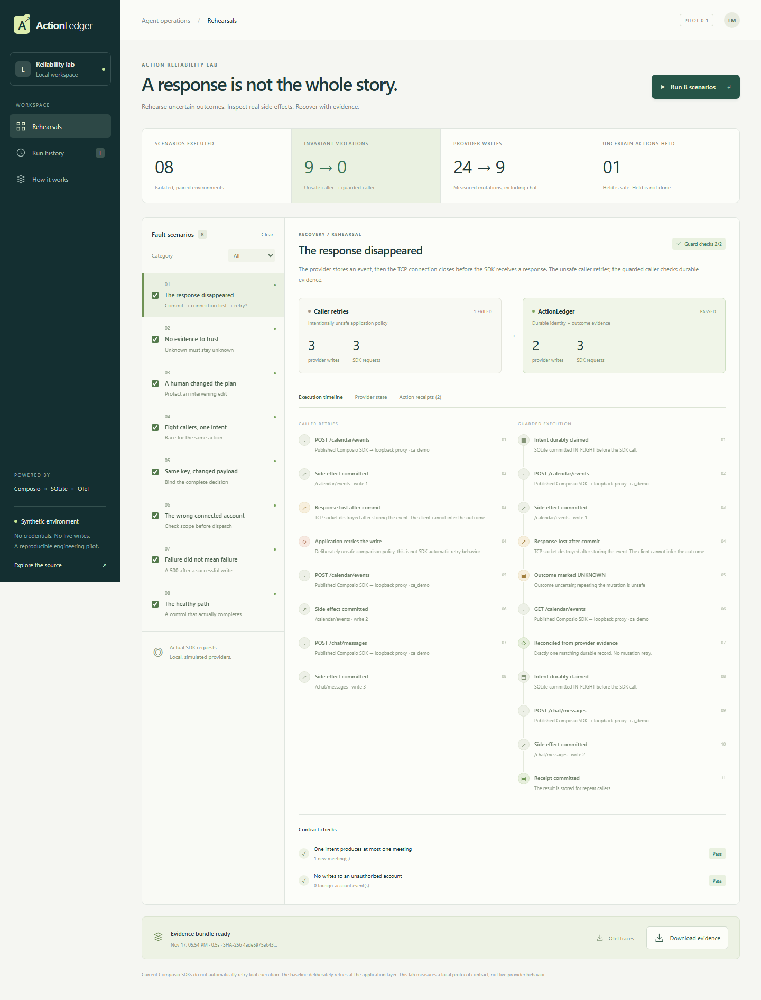
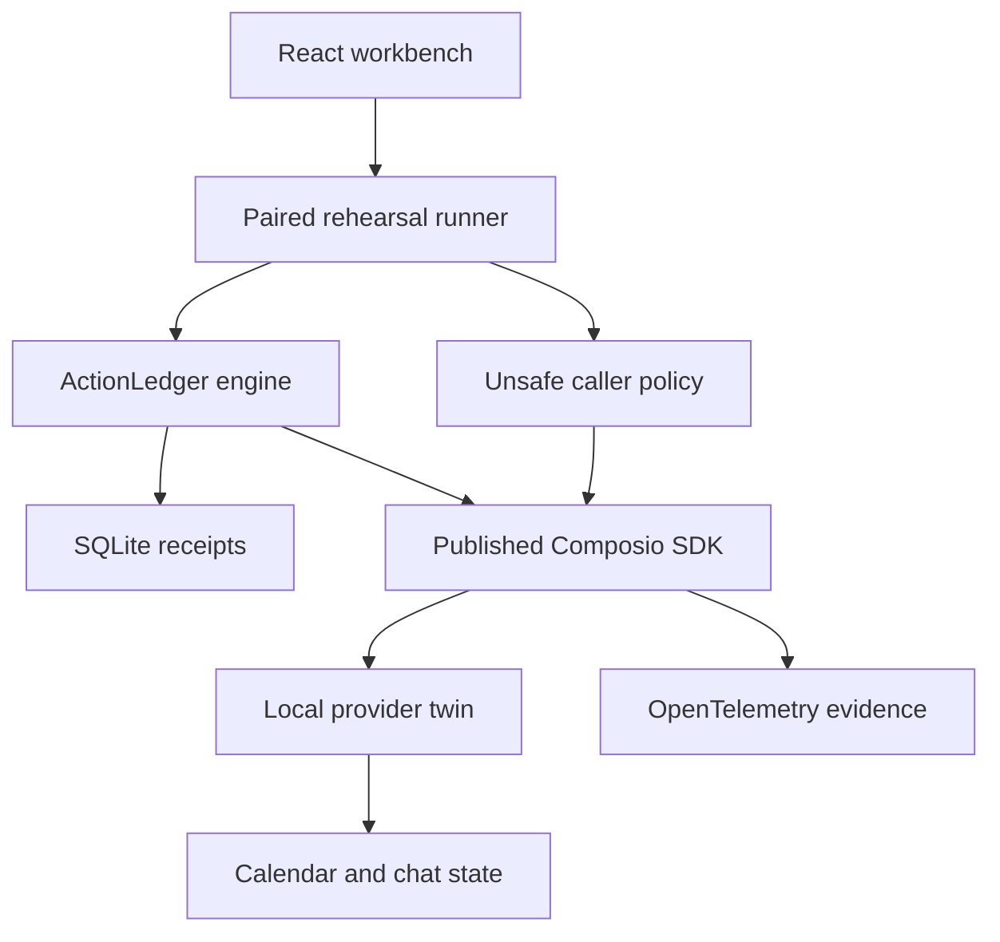

# ActionLedger

**A response is not the whole story.** Durable action receipts and uncertain-outcome rehearsals for agent tool calls.

[](https://github.com/liorma6/actionledger/actions/workflows/ci.yml)

[Open the interactive evidence demo](https://liorma6.github.io/actionledger/) · [Research and competitive landscape](docs/RESEARCH.md) · [Design-partner proposal](docs/PILOT.md) · [Validation](docs/VALIDATION.md)

An agent schedules a meeting. The provider creates it. The connection dies before the reply reaches the agent. Retrying can create another meeting; stopping leaves the workflow unresolved.

ActionLedger demonstrates a conservative alternative: record the intent before dispatch, bind it to exact inputs, then recover from a unique provider-side record when possible. Otherwise, hold the action and its dependent notification. **Held is not completed.**



## What runs here

- The published **`@composio/core` 0.29.0 SDK** makes actual HTTP proxy calls to a loopback protocol twin.
- A **SQLite ledger** atomically claims intents before dispatch, records transitions, and persists receipts across restarts.
- A local calendar/chat provider model commits effects, drops TCP responses, returns post-commit failures, and enforces conditional updates.
- **OpenTelemetry** records real spans. A **React** workbench compares provider state, decisions, receipts and execution traces.
- The public demo is an interactive explorer of a recorded synthetic run. Fresh execution runs locally or in CI.

Current Composio SDKs **already disable automatic tool-execution retries**. Our baseline is an intentionally unsafe **application-level retry policy**, not a claim about current SDK behavior. A dedicated integration test verifies one SDK request after a post-commit disconnect.

## Run a fresh rehearsal

Requires **Node.js 24.11+** and npm. Node's built-in SQLite currently emits an experimental warning.

```sh
git clone https://github.com/liorma6/actionledger.git
cd actionledger
npm ci
npm run build
npm start
```

Open **http://127.0.0.1:8789**. Select scenarios and run them. No API key or cloud account is required. The adapter rejects non-loopback provider URLs and SDK tracking is disabled.

```sh
npm run typecheck
npm test
npx playwright install chromium
npm run check
npm run demo:report
```

`npm run check` includes backend/integration tests, the production build, desktop/mobile Playwright flows, and recorded-demo tests. Linux CI installs Chromium system dependencies as well. `npm run demo:report` regenerates the evidence JSON and OTLP JSON in `docs/evidence/`. Report histories and individual action databases live under ignored `runtime/`.

## Eight paired scenarios

| Scenario | Deliberately unsafe comparison | Guarded outcome |
| --- | --- | --- |
| Response lost after commit | Caller retries and creates two events | Read-back evidence resolves one event; notification follows |
| No verification available | Caller repeats an uncertain mutation | UNKNOWN receipt; no notification |
| Human edits between read and write | Unconditional update overwrites it | Observed ETag sent as If-Match; 412 preserves the edit |
| Eight concurrent calls | Eight writes for one intent | One atomic claim, one dispatch |
| Same intent, different payload | Changed request creates another event | Fingerprint conflict before second dispatch |
| Wrong connected account | Misrouted caller writes to another account | Fixture account policy blocks before SDK call |
| Failure response after commit | Caller retries a committed mutation | Unique provider record resolves the outcome |
| Healthy control | One event and one notification | Same useful work completes |

The checked-in synthetic run measured **9 invariant violations → 0** and **24 provider writes → 9**, with **one UNKNOWN action held**. These are counts in this authored fault suite, not a production reliability rate, cost-saving estimate or benchmark of Composio. Some checks concern the same bad effect; nine violations do not mean nine separate incidents. Suppressed work includes intentionally blocked or unresolved actions.

## Architecture



The unique key is SHA-256 of `[tenant, intent]`; the fingerprint covers actor, account, tool, version, canonical JSON arguments and expected resource version. The intent must be stable for one logical decision. Generating a new intent for every retry bypasses deduplication. JSON canonicalization is local and deliberately strict; it is not an RFC 8785 implementation.

State transitions: `IN_FLIGHT → COMMITTED | UNKNOWN | REJECTED`; `UNKNOWN → COMMITTED` only after reconciliation. Terminal receipts cannot be overwritten. Repeat callers receive stored state. A process dying while IN_FLIGHT leaves a held record; this prototype has no lease expiry or automatic redispatch.

## Limits that matter

This is **not a universal exactly-once guarantee**, a production gateway, or a complete Composio/Google Calendar emulator. It does not invoke a real LLM or measure agent reasoning. Both lanes use deterministic scripted actions and synthetic data.

Reconciliation relies on the twin's durable, strongly consistent intent/fingerprint/account metadata and exact-one-match contract. A real provider needs its own verified correlation and consistency rules. Zero matches, multiple matches, a read timeout or missing capability do not authorize a retry. Read-back covers calendar creation only; ambiguous chat sends and patches remain held. An acknowledgment with a resource ID is trusted under the fixture contract, not proof that every arbitrary API's success envelope is truthful.

The fixture account allowlist is **not authentication or multi-tenant IAM**. No public action-execution endpoint accepts arbitrary tools, accounts or URLs. Production would require trusted identity binding, encryption, data minimization, retention, HA storage, fencing, provider validation and an operational review process. Local traces omit arguments and keys; synthetic receipts contain their inputs. A SHA-256 digest detects accidental changes but provides no signature or tamper-proof audit guarantee.

Temporal, Restate and DBOS already solve substantial durable-execution problems. This pilot explores a provider-specific recovery/evidence layer that could complement them. Observability and agent-evaluation products also overlap. See the research document before treating the prototype as a distinct business.

Independent pilot by **Lior Mashiach**, built with AI coding assistance. Not affiliated with or endorsed by Composio.
